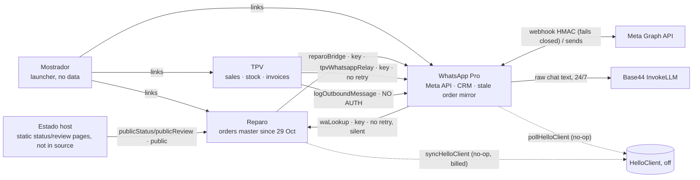
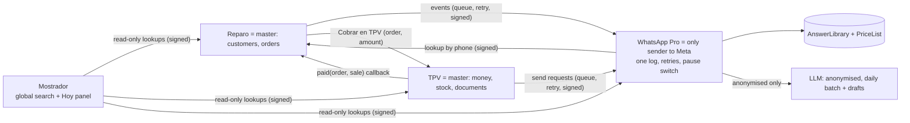

# Informática Torrent — Deep audit & improvement plan (final report)

Apps: Mostrador · Reparo · WhatsApp Pro · TPV (+ Estado) · Owner: Pcmatica Torrent SL · Date: 2026-10-30 · Auditor: Claude Code
Tags: **[VERIFIED]** code/data · **[MEASURED]** measured · **[ASSUMPTION]** to confirm.

Detailed evidence lives in the phase files; this report links to them:
- Phase 0: `00-access.md`
- Phase 1: `01-inventory-summary.md` and `*/inventory.md`
- Phase 2: `cross-app/data-flows.md`, `cross-app/customer-identity.md`
- Phase 3: `03-speed-summary.md`, `*/speed.md`, `live-measurements.md`
- Phase 4: `cross-app/security.md`
- Phase 5: `05-usage-summary.md`
- Phase 6: `cross-app/workflow.md`
- Phase 7: `cross-app/automations.md`
- Phase 8: `cross-app/knowledge-base.md`, `kb/top10-price-template.md`
- Decisions: `DECISIONS.md` (D-01…D-28) · Production changes: `CHANGELOG.md` · Backlog: `BACKLOG.csv` (64 items)

---

## 1. Executive summary

1. The four apps work and are used every day: ≈ 13 repair orders, ≈ 25 sales and ≈ 117 WhatsApp messages a day. The core flows are sound — status WhatsApps go out ≈ 62 s after a change, the barcode scan takes 12 ms, sales are immutable.
2. **Security is the main risk.** Several WhatsApp Pro functions run with full rights and **no login check**, including the one that sends WhatsApps from the shop number. A live Meta token is still stored in a settings table. The public status page reveals any phone's last 5 repairs. → **Week 1, P0.**
3. **Reliability gaps lose data silently:**
   - ≈ 220 Meta webhook deliveries were acknowledged and lost in October;
   - a sale retried after a network drop is duplicated;
   - 45 paid "we'll reply when we open" messages went to old chats in one burst on 26 Oct;
   - the Reparo customer card inside WhatsApp Pro may be empty without warning.
4. **No verified data backup** exists for orders, sales or invoices.
5. **Speed is acceptable.** TPV `/venta` takes 2.8–3.8 s to be ready because it reloads 9,100 products on every visit; Reparo search takes 0.9 s; WhatsApp Pro ships one 1.37 MB bundle.
6. **Waste:** HelloClient-era jobs still run every 5 minutes. Total automation credits drop **≈ 70 % (≈ 2,980 → ≈ 900 /month)** with no loss of function.
7. **Workflow:** the main cost is switching apps and re-typing phone, price and order number. "Cobrar en TPV", "Crear reparación" from the chat, and a Mostrador search/"Hoy" panel save **≈ 20–35 min/day**.
8. **Customer messages:** reminders for budgets, uncollected devices, parts and mail-in raise Meta fees from **≈ €6 to ≈ €10 /month**. Auto-reply goes live only for opening hours and location.
9. **Knowledge base:** a good structure exists (answer library + price list) but it is switched off. It is fed by an extractor that sends raw customer text to the AI. It must be cleaned (24/7 claims, piracy advice, contradictory warranties) and rebuilt on Joney's decisions D-18…D-24.
10. **Plan:** 64 backlog items. **Week 1 = 14 safety items**, then quick wins, then the bigger projects. Two production changes were made during the audit, both approved by Joney and logged in `CHANGELOG.md`.

---

## 2. Architecture

### 2.1 Current [VERIFIED, Phase 2]

### 2.2 Target

- Customer key = E.164 phone.
- No bulk mirrors; HelloClient and Doscar code removed.
- Every scheduled job runs only in D-12 shop hours.

---

## 3. Findings per area (headline; evidence in phase files)

| Area | Finding | Evidence |
|---|---|---|
| Inventory | 5 apps, 102 entities (≈ 29 empty), 88 functions. All Reparo/TPV users are admin. HelloClient and Doscar leftovers in 3 apps. | [VERIFIED] Phase 1 |
| Data flows | No Reparo ↔ TPV link (`repair_ref` filled on 0/69 sales). TPV→WA without retry. 2 unauthenticated write paths. WA keeps a frozen copy of Reparo orders and unlock codes. | [VERIFIED/MEASURED] Phase 2 |
| Identity | 3 phone formats, 3 consent models. Matching by normalised phone works; 2–4 % duplicates per app. | [MEASURED] sample of 50 |
| Speed | See §4. | [MEASURED] Phase 3 |
| Stability | Webhook acks failures (≈ 220 lost); `completeSale` not idempotent; Informes capped at 3,000 products; Reparo `events[]` lost updates; order number not atomic. | [VERIFIED] Phase 3 |
| Security | See §5: 0/4 data apps pass. | Phase 4 |
| Usage | WA Pro has an unused second order system and mini-POS. Auto-reply in "live" mode sent 0 messages since 2 Oct. Voice queue silent since June. Content feed unused since 26 Sep. | [MEASURED] Phase 5 |
| Workflow | Re-typing and app switching at intake, pickup and warranty. TPV `/tpv` cannot apply a deposit. Plain "Listo" sends no message. No mail-in process. Z close skipped some days. | [VERIFIED] Phase 6 |
| Automations | Off-hours ack burst (45 paid messages, 26 Oct). Escalation noise. 1,500–3,000 old "ready" orders must be excluded from reminders. | [MEASURED] Phase 7 |
| Knowledge base | 715 entries (≈ 528 unreviewed). Raw text to LLM. Unsafe approved entries. 9 contradictions, now resolved by D-18…D-23. | [VERIFIED/MEASURED] Phase 8 |

---

## 4. Speed table [MEASURED, Phase 3]

| Screen | Now | Target | Fix (backlog) |
|---|---|---|---|
| Mostrador home | 1.0 s | < 2 s | — |
| TPV `/venta` ready | 2.8–3.8 s | < 2 s | catalogue cache B-48 |
| TPV scan → cart | 12 ms | < 150 ms | ✅ |
| TPV product search | 19 ms | < 300 ms | ✅ (accent-insensitive later) |
| TPV payment → ticket | 0.7–1.9 s | — | idempotency B-12 |
| Reparo tickets list | 2.2 s, 31 calls | < 2 s | counts endpoint B-50 |
| Reparo search by order no. | 0.9 s | < 300 ms | fast path B-50 |
| Reparo open order | 1.9 s, 24 calls | — | lazy print chunk |
| Reparo status change | 1 write; WhatsApp after 60 s | < 500 ms | ✅ |
| WhatsApp Pro inbox | not measured live (audit browser session issue) | < 2 s | code-split B-49 |
| Console errors | TPV 0 · Reparo 0 · Mostrador 0 · WA Pro 2 (audit session only) | 0 | — |

---

## 5. Security checklist results [Phase 4]

| Control | Mostrador | Reparo | WhatsApp Pro | TPV | Estado |
|---|---|---|---|---|---|
| RLS matches roles | N/A | FAIL (latent) | FAIL | PARTIAL | N/A |
| No public write/PII functions | N/A | FAIL | FAIL | FAIL | N/A |
| Secrets only in env | OK | OK | **FAIL** | OK | OK |
| Meta HMAC fails closed | N/A | N/A | **OK** | N/A | N/A |
| Cross-app auth + rate limit | N/A | PARTIAL | FAIL | PARTIAL | N/A |
| Role + PIN on admin areas | N/A | PARTIAL | PARTIAL | PARTIAL | N/A |
| Audit log money/stock/price/status | N/A | PARTIAL | PARTIAL | PARTIAL | N/A |
| Minimisation, retention, GDPR | OK | FAIL | FAIL | FAIL | OK |
| Backups | N/A | UNKNOWN | UNKNOWN | UNKNOWN | FAIL |

Also from Phase 8: customer text reaches the LLM without anonymisation (rule 6) → **FAIL** (B-13, B-46).

---

## 6. Keep / merge / hide / remove [Phase 5 + decisions]

| Recommendation | Items |
|---|---|
| **Keep** | Inbox, templates, quick replies, push, scheduled messages, Reparo tickets/notify/unlock codes, TPV sale/caja/invoices/refunds/Pendientes, Verifactu (off until 2027), both TPV sale screens |
| **Merge** | Auto-reply engine + drafts into one AnswerLibrary-based engine; 4 report e-mails/digests into one morning brief; 3 review flows into one consented flow; 3 task stores into TPV Pendientes |
| **Hide (30 days) → remove** | WA Pro pedidos/ventas/inventario/tareas/taller and its unlock-code copy; HelloClient/Doscar importers (D-01); voice queue and content signals (D-03); chatbot flows; broadcasts (until a consented campaign); NPS; legacy ingest; TPV purchasing/units (D-02, hidden behind Ajustes) |
| **Remove** | `syncMessages`, `extractMemory`, `tmpReparoPing`, `zz*` tests, `cleanupTestData`, HelloClient jobs in schedulers, 9 legacy workflow files, empty entities (after 30 days) |
| **Archive (other apps)** | RepairTrack Pro, SyncRepair, App Hub, Informática Torrent Companion, Informática Torrent Portal, InventoryPro, SUDO Command Center, Inventario Visual Torrent (D-05). **TorrentConnect stays** (D-28). |

---

## 7. Workflow before / after [Phase 6, per occurrence; counts from code]

| Step | Before: clicks / typed / re-typed / switches | After |
|---|---|---|
| WhatsApp customer → new order | 4 / 1 / 1 / 1 | 1 / 0 / 0 / 0 (B-38) |
| Repair order form (non-phone devices) | ≈ 14 / ≈ 10 | ≈ 10 / ≈ 6 (B-25) |
| Status change + notice | 4 / 0 / 0 / 0 | 3 / 0 / 0 / 0, 💬 marks (B-24) |
| Budget answer from WhatsApp | 6 / 0–1 / 1 / 1 | 2 / 0 / 0 / 0 (chat card, after B-14) |
| Pickup → charge → ticket | ≈ 16 / 4–5 / 3–4 / 2 + 6–8 s loading | ≈ 5 / 0 / 0 / 1 (B-40) |
| Uncollected reminder | ≈ 5 clicks + free text, personal WhatsApp | 0, automatic (B-41) |
| Warranty: find original sale | ≈ 5 / 1 / 1 / 1 | 1 click (B-40 link) |
| Deposit | not used (D-06) | — |

**Estimated saving ≈ 20–35 min/day.** Assumptions are listed in `workflow.md` §4.

---

## 8. Automation catalogue and cost [Phase 7, updated with D-13…D-28]

| ID | Automation | Rec. | Meta €/month |
|---|---|---|---|
| A-01/A-04 | Status WhatsApp after 60 s, debounced; + Esperando material (T-01) and Pieza recibida (T-02) | ON (extend) | 4.6 |
| A-02 | Budget reminder 24 h + staff alert 72 h | ON | 0.4 |
| A-03 | Uncollected 3/7/15 days (new orders only); final notice = gestoría clause (D-14) | ON | 2.1 |
| A-05 | Unanswered chat alert (one level, admin mobile, D-26); off-hours ack event-driven | ON (changed) | 0.8 |
| A-06 | FailedSend retry + list in brief | ON (extend) | 0 |
| A-07 | Review request: consent only, direct Google link (D-17) | ON after consent check | 2.0 |
| A-08 | Warranty ending | OFF | 0 |
| A-09a | 13:00 Pendientes WhatsApp to Japji, Mon–Sat (D-27) | ON (fixed) | 0.4 |
| A-09b/c | Cash-not-closed banner; reports merged into brief | ON (merged) | 0 |
| A-10 | Morning brief, **e-mail only** (D-15) | ON | 0 |
| A-11 | Mail-in messages (T-07 updated below, T-08) | ON | 0.3 |
| A-12 | Health check, push + e-mail only (D-15) | ON | 0 |
| A-13 | Auto-reply Horario + Ubicación (T-09/T-10) | ON | 0 |
| A-14 | Global pause switch | ON | 0 |

**Monthly cost, today vs recommended:**

| Line | Today | Recommended |
|---|---|---|
| Workflow credits | ≈ 1,979 | ≈ 412 |
| LLM credits | ≈ 960 | ≈ 450 |
| E-mail credits | ≈ 40 | ≈ 35 |
| **Credits total** | **≈ 2,980** | **≈ 900** |
| **Meta fees** (worst case, every template billed, + VAT if invoiced) | **≈ €6** | **≈ €10** |

- The plan stays within the Builder plan (50 USD/month) [ASSUMPTION — check the Base44 usage page].
- Confirm the Meta rate card in WhatsApp Manager → Billing [ASSUMPTION: utility ≈ €0.0166, marketing ≈ €0.05].

**T-07 re-worded after D-20 — BORRADOR, needs Joney's OK:**
"Hola {nombre}, hemos registrado su reparación por mensajería (Orden #{orden}). Envíe el equipo con GLS o Correos Express (envío a su cargo) a: Informática Torrent, C/ Germanies 74 bajo, 46900 Torrent (Valencia). Protéjalo con plástico de burbujas en una caja rígida ajustada; no incluya cables, fundas ni tarjetas SIM/SD salvo que se las pidamos para el diagnóstico (para la modificación de Switch puede enviar su propia microSD de 128/256 GB o comprarla en tienda). Le avisaremos al recibirlo. El pago se realiza por Bizum o transferencia cuando la reparación esté terminada; la devolución la gestionamos nosotros por 10 € (o 19 € ida y vuelta si lo prefiere)."

---

## 9. Knowledge base: audit, design, sample [Phase 8]

**Audit.** KnowledgeBase has 715 entries: ≈ 171 approved, ≈ 528 pending. AnswerLibrary has 23 topics, 0 live. PriceList has 12 keys, 11 confirmed. `liveKBCheck` sends raw transcripts to the LLM, ≈ 480 credits/month.

**Sample of 30.** USE 9 · EDIT 11 · DROP 10, of which 3 are legal or ethical risks. 0 contained personal data.

**Design** (improve, not rebuild):
- AnswerLibrary is the only approved source.
- PriceList holds every volatile price (top-10 template ready, `kb/top10-price-template.md`).
- KnowledgeBase becomes a candidate inbox.
- Anonymiser before any LLM call; daily batch at 14:15; review queue of ≤ 10 per day.
- DraftFeedback for the learning loop.
- Drafts in Spanish only (D-24).
- AI never answers on FRP or game/ROM downloads (D-23).

**Cost:** extraction ≈ 480 → ≈ 85 credits/month, plus 60–100 once for the history pass.

**Policies now decided:**
- Warranty: 3 months for repairs, 1 year for the Switch mod (D-18).
- Diagnosis: free (D-19).
- Mail-in: customer ships with GLS/Correos Express; return by the shop 10 € or 19 € both ways (D-20).
- Payment: counter cash/card/Bizum; mail-in Bizum or transfer before return (D-21).
- No 24/7 service (D-22).

---

## 10. Top 10 quick wins (weeks 1–2; small effort, high score)

| # | Item | Score |
|---|---|---|
| 1 | B-01 Authenticate `sendMessage` | 8 |
| 2 | B-03 Clear and rotate leaked secrets | 6 |
| 3 | B-04 Undeploy test/temp functions + `cleanupTestData` | 7 |
| 4 | B-08 Off-hours ack event-driven (no bursts) | 7 |
| 5 | B-10 Global pause switch | 7 |
| 6 | B-13 Stop raw-text LLM extraction; archive unsafe KB entries | 7 |
| 7 | B-14 Fix/verify Reparo card in WhatsApp | 7 |
| 8 | B-35 Invite-only registration on all apps | 7 |
| 9 | B-16 Reparo workflow without HelloClient (−≈ 1,050 credits) | 5 |
| 10 | B-22 13:00 Pendientes fix (Mon–Sat, all tasks, retry) | 5 |

## 11. Top 5 bigger projects

| # | Project | Why |
|---|---|---|
| 1 | B-09 Daily data backup + restore test | Irrecoverable-loss risk; legal retention of invoices |
| 2 | B-40 "Cobrar en TPV" + order↔sale link | Biggest daily time saver; links warranty to sale |
| 3 | B-47 Mostrador "Hoy" panel + global search | Removes most app switches and re-typing |
| 4 | B-46 Knowledge base pipeline (anonymised, library-only) | Better drafts, privacy compliance, −80 % extraction cost |
| 5 | B-39 Roles/RLS hardening (+ B-55 cajero/PIN) | Closes latent full-data access before any new staff account |

## 12. Suggested 4-week order

| Week | Theme | Items |
|---|---|---|
| 1 | **P0 safety + stop the bleeding** | B-01, B-02, B-03, B-04, B-05, B-06, B-07, B-08, B-10, B-13, B-14, B-15 (gestoría decision), B-35; start B-09 |
| 2 | Quick wins and clean-up | B-09 finish, B-11, B-12, B-16, B-17, B-18, B-19, B-20, B-22, B-23, B-25, B-26, B-27, B-28, B-29, B-31, B-59, B-60 |
| 3 | Data integrity + better messages | B-21 (after 1 shadow week), B-24, B-30, B-32, B-33, B-34 (with Joney's prices), B-36, B-37, B-38, B-64 |
| 4 | First projects | B-40, B-41 (shadow first), B-42, B-43, B-44, B-57, B-58 |
| After | Projects and removals | B-39, B-45, B-46, B-47, B-48–B-56, B-61, B-62 (only after 30 days hidden and Joney's yes), B-63 |

Each batch follows AUDIT §7: checkpoint first, small themed changes, tests for pure logic, build + correct function redeploy, test in Chrome with Joney logged in (WhatsApp only to his test number), report ≤ 8 lines in Spanish.

---

## 13. Risks and mitigations

| Risk | Mitigation |
|---|---|
| Locking staff out when RLS/auth changes | Non-admin test account matrix; one app per batch; checkpoint before each deploy |
| Meta redelivery duplicates after B-07 | Unique `meta_message_id` dedupe before switching the ack behaviour |
| Reminders spamming the old "ready" backlog | `ready_at` set only for new transitions; shadow week; pause switch |
| Wrong automatic answer (prices, policy) | Only Horario/Ubicación live; prices only from PriceList; AI blocklist for sensitive topics |
| Meta template re-classified as marketing | Reminder texts purely informative; review category monthly in WhatsApp Manager |
| Removing something still needed | Hide 30 days first; Joney confirms each removal; data archived, never deleted |
| Base44 platform limits (rate limits, truncated APIs) | Batched reads, no per-record loops (sendNPS lesson), schedulers only in shop hours |
| Credit or Meta budget overrun | Brief shows monthly sends; health check flags spikes |

---

## 14. Open questions only Joney (or the gestoría) can answer

1. **Q-1 (D-23):** the wording of the FRP and ROM decisions is ambiguous. Confirm:
   - (a) Is proof of ownership required to remove a Google account? Auditor recommends yes.
   - (b) Are the game/ROM download entries deleted, or only blocked from the AI?
   Until confirmed: never answered by AI, entries archived.
2. **Q-2:** invoice numbers F 2600408–2600411 clash with Doscar → gestoría decision (keep / cancel / rectify).
3. **Q-3:** legal custody clause for the 1-year final notice (gestoría, D-14).
4. **Q-4:** retention periods in `security.md` §5 (unlock codes, chats, inactive customers, logs).
5. **Q-5:** who works as **cajero** (no prices/Ajustes) vs admin, in TPV and Reparo?
6. **Q-6:** prices for the top-10 template (`kb/top10-price-template.md`).
7. **Q-7:** OK to the re-worded T-07 (§8)?
8. **Q-8:** monthly budget ceiling for Meta fees and Base44 credits; confirm the plan's credit allowance and the Meta rate in WhatsApp Manager.
9. **Q-9 (AUDIT §9):** receipt/label printer and scanner models; is the cash drawer on the printer? (Needed for label printing and the cash-close banner.)

---

## 15. Definition of done (AUDIT §8)

| Item | Status |
|---|---|
| All 4 apps inventoried with evidence | ✅ (+ Estado) |
| Cross-app diagram + identity analysis | ✅ |
| Speed measured on real screens | ✅, except WhatsApp Pro inbox (audit-browser session issue; to measure on the counter PC) |
| Security checklist | ✅ (7 live checks listed in `security.md` §6, of which `tmpReparoPing` deployment is still to confirm) |
| Unused/duplicate table for yes/no | ✅ (answered: D-01…D-05) |
| Workflow before/after with clicks | ✅ from code; a 20-min live stopwatch session at the counter is still recommended |
| Automation catalogue with costs | ✅ |
| KB audit, design, 30-sample, cost | ✅ |
| REPORT.md, BACKLOG.csv, RESUMEN_JONEY.md | ✅ |
| No changes to any app; no customer messaged | ⚠️ **Two production changes, both approved by Joney in chat** (TPV invoice counter; masterTick `sendNPS` paused) — logged with rollback in `CHANGELOG.md`. No customer was messaged by the auditor. |

**The audit now stops and waits for Joney's approval of this report and the backlog** before any implementation batch.
