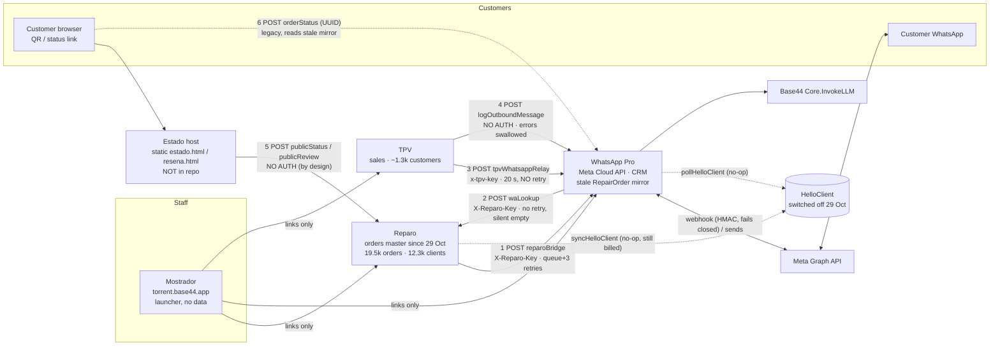
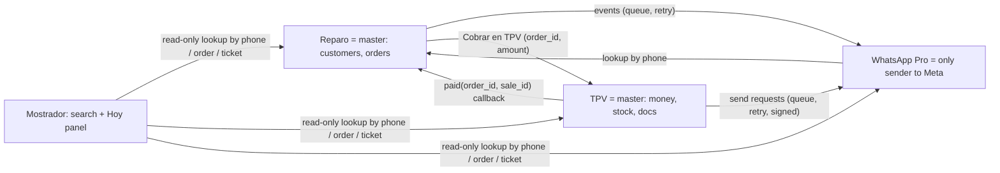

# Phase 2 — Cross-app data flows

Sources: Phase 1 inventories + lead-auditor code checks on 30 Oct (files cited). Tags: [VERIFIED] code/data · [MEASURED] · [ASSUMPTION].

## Current architecture

## Flow table

| # | Direction | Endpoint | Auth | Payload | Retries / idempotency | If the target is down | Evidence |
|---|---|---|---|---|---|---|---|
| 1 | Reparo → WA Pro | `reparoBridge` (secret `REPARO_WA_URL`) actions `event`, `ping`, `set_master`, `hc` | header `X-Reparo-Key` = `REPARO_WA_KEY`, plain `!==` compare | `ticket_created`/`status_changed`, status, customer name/phone, device, fault, estimated cost | Queue `WhatsAppQueue`: waits 60 s, skips if status changed again, 3 attempts every 2 min on 5xx/timeout, 5-min sweep for stuck rows. WA side has a 1-hour duplicate guard (ActivityLog) so a timeout + retry does not double-send. ✅ best-designed flow. | Rows stay `pending` → retried → `failed` after 3; visible in queue (19 done / 3 skipped / 0 failed) | [VERIFIED] Reparo `notifyWhatsApp/entry.ts:28-32,86-160`; WA `reparoBridge/entry.ts:3,18,163-164` |
| 2 | WA Pro → Reparo | `https://reparo-812bcab8.base44.app/api/apps/6ae2…/functions/waLookup` (hard-coded) from sendMessage, generateDraft, libraryAutoReply, clientCard, customerOverview | `X-Reparo-Key` | phone → client + recent orders | none; errors → empty result | Chat card / AI draft silently lacks order data (no error shown) | [VERIFIED] WA inventory §10; Reparo `waLookup:45-48` |
| 3 | TPV → WA Pro | `tpvWhatsappRelay` (TPV secret named **`REPARO_RELAY_URL`**: legacy name, WA Pro was once called "Reparo"/"Inbox Pro") | `x-tpv-key` (constant-time compare on WA side) | `template` lookup, `send` approved template (Pendientes digest, tickets/invoices) | 20 s timeout, **no retry**; first 13:00 digest failed with 502 and was lost | Message lost; logged in TPV MessageLog only | [VERIFIED] TPV `sendPendingDigest/entry.ts:28-52`; WA `tpvWhatsappRelay/entry.ts:5-11,34-35` · target = WA Pro [ASSUMPTION, strong: no relay function exists in Reparo] |
| 4 | TPV → WA Pro | `logOutboundMessage` (TPV secret `INBOX_PRO_ENDPOINT`) | **none** sent; WA has secret `OUTBOUND_LOG_SECRET` but never checks it | phone, text, PDF URL of ticket/invoice | 10 s, no retry, errors swallowed | Copy of sent doc missing from chat history | [VERIFIED] TPV `shared/inboxPro.ts`; WA inventory finding 2 |
| 5 | Customer → Reparo | `publicStatus`, `publicReview` called from Estado static pages | none (public by design) | ticket UUID **or phone** → last 5 orders | rate limit 10/10 min per IP, skipped without IP header | Status page shows error | [VERIFIED] Reparo `publicStatus:44-55`; [MEASURED] Estado pages 200 |
| 6 | Customer → WA Pro | `orderStatus` (UUID) | none (UUID) | ticket UUID → status | — | — | [VERIFIED] WA `orderStatus/entry.ts:12-27`: reads WA's **own RepairOrder mirror, frozen since 29 Oct 12:01** [MEASURED] → any old QR pointing here shows stale status. Who still links here: [ASSUMPTION] old HelloClient-era QRs. |
| 7 | WA Pro ↔ Meta | webhook in, Graph sends out | HMAC SHA-256, fails closed | messages, statuses | FailedSend + retry job (in masterTick) | — | [VERIFIED] WA inventory (b) |
| 8 | Reparo/WA → HelloClient | `syncHelloClient`, `pollHelloClient`, bridge `hc` proxy | cookie (secret not set) | — | — | **Dormant** since cutover (`orders_master=app`) but still invoked every 5 min | [VERIFIED] |
| 9 | Website → WA Pro | `exportContentSignals` | `x-signals-secret` | anonymised content feed | — | — | [VERIFIED] |
| 10 | External → WA Pro | `ingestChatHistory`, `ingestChatKnowledge`, `ingestClientFromShop`, `getUnspokenAlerts` | `IMPORT_SECRET` (value also still in a SystemSettings row) | — | — | — | [VERIFIED] |
| — | Mostrador ↔ all | links + app-switcher (`src/lib/appSwitcher.js`, copied ×3) | — | — | — | — | [VERIFIED] |

## Findings
1. **[VERIFIED] No Reparo ↔ TPV data link at all.** TPV has only a free-text `repair_ref` on Sale/Deposit; **0 of 69 live sales (since 28 Oct) have it filled**, Deposit has 0 rows [MEASURED]. Reparo has its own empty `Sale`/`Product` entities. → Cannot go from an order to its señal/ticket or back. Core input for "Cobrar en TPV" (Phase 6).
2. **[VERIFIED] TPV → WhatsApp has no retry** (flows 3, 4); Reparo's queue pattern (flow 1) is the model to copy.
3. **[VERIFIED] Two unauthenticated write paths into WhatsApp Pro** (flow 4 `logOutboundMessage`; plus `sendMessage` from Phase 1).
4. **[MEASURED] WhatsApp Pro keeps stale copies** of Reparo data (RepairOrder 1–5k rows, DeviceUnlockCode 1k+, OrderState), last written 29 Oct ≈ cutover. `orderStatus` (flow 6) still reads them. Single source should be Reparo via `waLookup`.
5. **[VERIFIED] Secret naming confusion:** TPV calls WhatsApp Pro "Reparo" (`REPARO_RELAY_URL`, error text "Reparo ha respondido…", comment "WhatsApp Inbox Pro (Reparo)") — this is how the first digest failure was mis-attributed to Reparo in Phase 1. Cosmetic but misleading when debugging.
6. **[VERIFIED] Shared secrets compared with `!==`** in Reparo-facing endpoints (timing-safe compare only in `tpvWhatsappRelay`). Low risk, easy fix.
7. **[VERIFIED] HelloClient calls** still execute every 5 min in both Reparo and WA Pro and do nothing.

## Target (proposal, detail in Phase 6/9)

